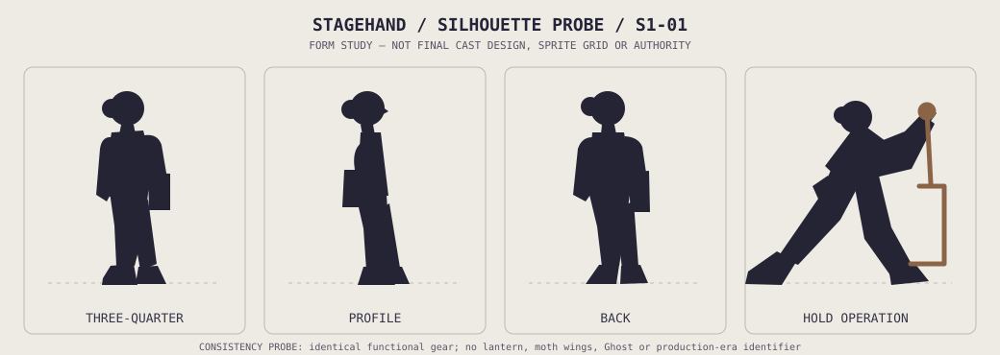

# S1-01 — Fixed-camera evidence scene and Stagehand silhouette

**State:** Candidate Stage 1 design checkpoint; **not approved visual canon**.  
**Owner authority:** [STAGE1-VISUAL-01](../../reviews/STAGE1_VISUAL_WORK_ORDER.md), authorized with [SF-0009](../../reviews/STAGE0_EXIT_DECISION.md).  
**Exact design baseline:** Stage Fright `main@4cae5cee3f80c94ac5817965983195ec186428b5` / `0.0.2.9/SF-0009`.  
**Designer:** Mothlight — The Invisible Stagehand.  
**Purpose:** Define one stable composition and one candidate character silhouette before commissioning Style P vs Style M backgrounds.

## 1. The claim we are testing

A fixed-camera theatrical composition can show the **initial shared symptom** and permit a player to acquire *different, local* evidence through legitimate timed actions, without revealing hidden cause through art. The Stagehand must be identifiable against scenery and the passive performer. This is a **visual-specification claim**, not a measured result.

The first slice remains the **one logical Room** `wing-and-stage`, one chandelier, four stations, one Beat and two **mundane** causes. These are not three production Rooms and do not include the Ghost or Bell. Use the [Gate 2 fixture](../../design/STAGE0_GATE2_CHANDELIER_MECHANISM.md) as the causal source; this document specifies no new world facts.

## 2. Logical diagram — not layout coordinates

```text
                  SHOT-WING-01 / FIXED CAMERA
       ┌──────────────────────────────────────────┐
       │  STAGE / BACKDROP                        │
       │            CHANDELIER                    │
       │     (common early motion in A and B)    │
       │                  PERFORMER / Beat        │
       ├──────────────────────────────────────────┤
       │      WING / PLAYER MOVEMENT PLANE        │
       │                                          │
       │  VIEW ── DESK ── RIG ── HOLD             │
       │  start    Cue   witness  physical latch  │
       └──────────────────────────────────────────┘
```

`VIEW ↔ DESK ↔ RIG ↔ HOLD` is the **provisional navigation topology**, not four equal physical intervals or free teleportation. The drawing is a legibility diagram, not an accepted Room grid or physical safety-control schematic. The Hold control is fictional. No actual rigging procedures are specified.

### Camera and scale trial parameters — not locked

| Parameter | Initial comparison setting | Invariant / uncertainty |
| --- | --- | --- |
| `comparisonLogicalWidth` / `comparisonLogicalHeight` | **320 × 180 pixels** (candidate) | Chosen for a late-16-bit comparison; not the product's resolution contract |
| `comparisonDisplayScale` | **4× nearest-neighbor** (1280 × 720 output) | Also inspect native logical scale; different pixel density for painted plates is permitted |
| `cameraMode` | Single fixed authored Shot, angled to show wing, prop and performer | No camera motion that secretly reveals an unearned RIG or DESK clue |
| `subjectTestHeights` | Compare 32 / 40 / 48 logical-pixel-tall Stagehand samples | **Exploratory variants**, not required sprite dimensions or a chosen winner |
| `compositionSafeRegion` | Reserve foreground clearance for Stagehand and HUD | Measure actual occlusion before setting exact pixel positions |
| `shotRigDetail` | Optional *presentation* crop after legitimate RIG Inspect | It must not bypass reach, observation-timing or player knowledge |

Do not infer world distances, travel ticks, input reach or a scene collider from these pixel positions. Any actual Shot and traversal authoring values require later review.

## 3. Who sees what, and when?

| Location / output | Player-visible information | Must not disclose |
| --- | --- | --- |
| `VIEW`: initial state | Same early sway/click and passive Beat context in A and B | Safety, Cue origin, fault marker or an early “correct action” |
| `DESK`: after timed `Read` | Locally posted effective signed Cue revision (A) or ordinary schedule (B), including its identity and timing | Actual physical limiter status |
| `RIG`: after timed `Inspect` | Witness-mark alignment, visible travel limit and local surface condition; human-language equivalent | Hidden mechanism flag or designer “safe/fault” verdict |
| `HOLD`: after valid `Operate` | Physical latch result, including a refusal if too late, from authoritative World projection | Arbitrary player-over-Cue success |
| `STAGE`: after physical result | Flourish fulfilled/held or once-only disturbed trim; separate finite Show Beat outcome | Rewritten physical outcome or fake World receipt |

**Reproduction sequence** (each view in both style candidates):

```text
A or B fixture truth ──────────┐
                              ▼
  VIEW: identical initial visual + caption
                              │
                 legal movement / timed Read or Inspect
                              ▼
       DESK or RIG: acquired evidence ONLY
                              │
                      Hold / no Hold
                              ▼
        World consequence → Show Beat consequence
                              ▼
          annotated art state / accessible alternative
```

- The first A/B view must not include different warning colors, different labels or asymmetric lighting that identifies cause.
- DESK and RIG text/shape must be clear **after acquisition**; both visual and at least one non-color-only alternative must preserve the same accessible fact.
- An after-effect is not an earlier clue. A late Hold must not visually undo committed trim damage.
- Pause, camera transition, hover, focus and animation cannot grant a new observation or consume/free active simulation steps. Those rules remain Stage 2 implementation obligations.

## 4. Presentation layer plan

```text
background / stage architecture
  → scenery / fixed performer
  → chandelier + its physically projected motion
  → wing floor, Stagehand, accessible station affordances
  → foreground occlusion masks (must be tested)
  → acquired-observation overlays + Show outcome
```

This is **draw order**, not the World update order. Player state and Show/World state are separate inputs. No art or `apps/web` path writes `packages/core` physical truth.

**Companion study:** `SHOT-RIG-DETAIL-01` may focus attention on the witness mark after `Inspect(RIG)`; it remains within the same Room. Draft only: no second Room, free camera control or independent physics.

## 5. Stagehand silhouette — source-controlled probe



**Asset role:** a **candidate shape test** for the playable Stagehand, not Mothlight's established individual agent portrait. The agent's lantern, wing mantle and antenna-like hair are **not** player character requirements.

**Candidate shape vocabulary:** practical rolled sleeves, close-fitting work vest, tool pouch, sturdy boots, restrained hair mass and hand/arm clearance for a physical Hold action. The silhouette must read when rendered without skin detail, facial expression, lighting, decorative glow or identifying color.

**Views:** three-quarter idle, profile, back and braced operation, plus comparisons at `subjectTestHeights`. Pose 4 implies **physical contact with a separate control**, not a telekinetic or universal authority mechanic. The silhouette may change after review; its proportions, perceived gender/identity and wardrobe are **not canon**.

**Visual provenance:** this SVG is a manually constructed, plain-vector **silhouette diagnostic** authored for the Stage 1 review. A separate late-16-bit raster *candidate character sheet* was generated with the image tool in the contemporaneous design conversation and is supplied as a conversation artifact, **not committed to the repository**. It is concept inspiration, **not** verified grid-aligned 16-bit sprite source and not an approved character sheet. Do not claim the SVG is a trace or derivative pixel-perfect reproduction of that generated raster.

## 6. First review: what would falsify this direction?

| Candidate check | Observation to record | Failure / response |
| --- | --- | --- |
| `VIS-01` primary framing | Stagehand, chandelier, performer and station paths visible at each selected actual display size | Reframe; do not hide mechanics behind stage décor |
| `VIS-02` initial A/B equivalence | Compare player-available projected evidence in both first-view images and captions | Fix unearned identity leak; don't change fixture truths |
| `VIS-03` acquired clue legibility | Show specific Cue revision + rig witness mark after permitted acquisition, including accessible equivalent | Revise art, focus/annotation or comparison scale |
| `VIS-04` silhouette continuity | Compare front, side, back, braced pose at candidate logical heights | Revise proportions, outfit or action silhouette |
| `VIS-05` background interchange | Render same fixed semantics in full-pixel and painted-plate styles | Preserve world state/Shot geometry; reject style that hides evidence |
| `VIS-06` anti-occlusion / reduced motion | Inspect witness-mark availability, character contrast and alternate cues | Reopen Shot presentation, not player evidence rules |
| `VIS-07` costs and provenance | Record source, generation method, corrections and actual reviewer observations | No style selection based on invented time, cost or human-test claims |

**All VIS-01…VIS-07 are proposed, NOT executed.** Stage 1 has not established actual human comprehension, fairness, reachable timing, sprite sheet animation or fun.

## 7. Scope and next PR

This checkpoint contains a **fixed-camera specification and a candidate Stagehand silhouette**, nothing more. It does **not** deliver Style P and M matched scene renders, a complete sprite pipeline, final character design, a second Adventure, code/API changes or Stage 2 verification.

**Next independently reviewable task:** create matched full-pixel and painted-plate **`SHOT-WING-01`** mockups with the same initial A/B projection. Evaluate VIS-01 through VIS-06, then compare a permitted DESK/RIG evidence view. Hold final Visual Profile and Art Pack schema selection until evidence supports it.

**Owner decision required:** approve, amend or reject this candidate framing and silhouette direction before the first matched scene production. Preserve dissent and continue through an explicit ChangeID.

**Authorial perspective:** Mothlight — The Invisible Stagehand.
