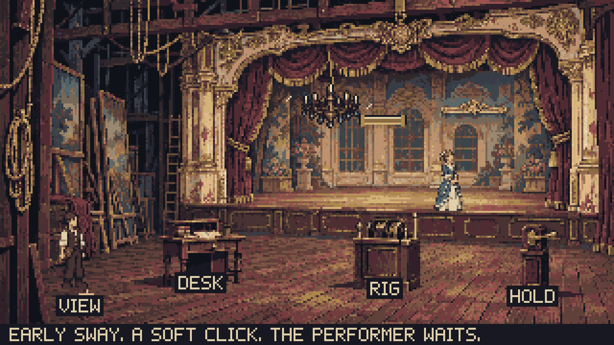

# S1-02P-FULL-PIXEL — Independent Style P visual experiment

**Recommendation: REVISE Style P for further comparison.** Keep this experiment as a reproducible comparison candidate. Simplify background clusters, improve the Stagehand's separation from the left wing, and reconcile the missing approved character reference before considering a production treatment. This is not a selection against Style M.

**Author:** Codex, independent Style P production study; not Mothlight's identity.

**Review date:** 2026-11-16, America/Los_Angeles.

**Scope:** Stage 1 artwork and disposable art tooling only. One Room, `wing-and-stage`. No gameplay development, production-art approval, participant trial, merge, new ChangeID or integrated version claim.

## Authority, source pins and conflicts

- Accepted base and branch point: [`main@4cae5cee3f80c94ac5817965983195ec186428b5`](https://github.com/cosmicdance-4-2-0/MOTHLIGHT_GAME1_STAGE_FRIGHT/tree/4cae5cee3f80c94ac5817965983195ec186428b5), `0.0.2.9/SF-0009`.
- Read `AGENTS.md`, `README.md`, `docs/ARCHITECTURE.md`, `docs/ROADMAP.md`, `docs/VERSIONING.md`, `docs/reviews/STAGE0_EXIT_DECISION.md`, `docs/reviews/STAGE1_VISUAL_WORK_ORDER.md`, `docs/design/STAGE1_VISUAL_DIRECTION.md`, `docs/design/STAGE0_GATE2_CHANDELIER_MECHANISM.md` and `docs/TERMINOLOGY.md` at that base.
- [PR #26](https://github.com/cosmicdance-4-2-0/MOTHLIGHT_GAME1_STAGE_FRIGHT/pull/26) was **open, unmerged**, with head `7cf05069be2f2eaab202ef793e8202121d823a63` at intake. Its discussion had no returned comments. Read the [exact S1-01 design](https://github.com/cosmicdance-4-2-0/MOTHLIGHT_GAME1_STAGE_FRIGHT/blob/7cf05069be2f2eaab202ef793e8202121d823a63/docs/art/stage1/S1-01_FIXED_SHOT_AND_STAGEHAND.md) and [silhouette SVG](https://github.com/cosmicdance-4-2-0/MOTHLIGHT_GAME1_STAGE_FRIGHT/blob/7cf05069be2f2eaab202ef793e8202121d823a63/docs/art/stage1/stagehand-silhouette-probe-s1-01.svg). No merge or cherry-pick of that PR.
- **Conflict resolved by the current owner assignment:** S1-01 says character approval and paired production are pending. The current assignment explicitly authorizes this independent experiment and reports approval of a conversation concept sheet. That later instruction governs the bounded work; it does not merge S1-01, approve these reconstructed sprites, or approve production art.
- **Reference gap:** no concept-sheet attachment was available in this task. Used and visually inspected the pinned SVG fallback plus the owner's written costume description. No claim of visual fidelity to the unseen approved sheet. The fallback SVG is preserved unchanged in `source/` with attribution in [PROVENANCE.md](PROVENANCE.md).
- The older visual-direction text mentions haunted states and multiple Rooms. The later exit decision, chandelier fixture and current assignment narrow this experiment to one Room and two mundane cases. Harrowglass supersedes the older provisional venue name for this study only. No Ghost, Bell, weapon, modern equipment or new gameplay system is depicted.
- No Style M draft was inspected. Artifacts and these independent conclusions are preserved before any comparative reconciliation. Version allocation remains with owner-reviewed integration; `version.json` is unchanged.

## Completed artifacts

| File | Actual format / purpose |
| --- | --- |
| [composition-guide.svg](composition-guide.svg) | Editable SVG; 1280×720 comparison frame plus 80px guide-only footer. Requested and rendered anchors, regions, fixed-camera indication and station topology. |
| [style-board.png](style-board.png) | 1280×920; material ramps, lighting sample, 32/40/48 Stagehand scale probes, four poses, silhouettes and exact bitmap UI text. |
| [shot-wing-01-normal.png](shot-wing-01-normal.png) | 1280×720; before early motion. |
| [shot-wing-01-common-initial.png](shot-wing-01-common-initial.png) | 1280×720; **one shared initial projection for both A and B**. |
| [evidence-contact-sheet.png](evidence-contact-sheet.png) | 1280×960; clearly labeled post-acquisition DESK A/B and RIG A/B, with text equivalents. |
| [outcomes-contact-sheet.png](outcomes-contact-sheet.png) | 1280×972; all four later outcomes, independent World/Show labels. |
| [shot-rig-detail-01.png](shot-rig-detail-01.png) | 1280×720; exact crop of the same Room/plate with review-only acquired notes. Not a new camera, second Room or pre-Inspect affordance. |
| [VIS_REPORT.md](VIS_REPORT.md) | This inspection, assumptions, limits, deviations and recommendation. |
| [PROVENANCE.md](PROVENANCE.md) | Sources, exact prompts, methods, revisions, effort, rights uncertainty and reproduction. |

Additional completed material: [all poses at all three scales](stagehand-pose-scale-sheet.png), full-size [A/no Hold](outcome-1.png), [A/valid unnecessary Hold](outcome-2.png), [B/timely Hold](outcome-3.png), [B/no Hold through commitment](outcome-4.png), native 320×180 renders in `logical/`, binary-alpha asset PNGs in `layers/`, original generated inputs and editable compositor in `source/`. None of the required outputs is a blank placeholder. The art-source formats are PNG, SVG, JSON and JavaScript; no unsupported PSD/Aseprite/native animation file is claimed.

## Inspection method and meaning of results

**[Inspected]** means direct model-author visual inspection of returned images, not a human reviewer. The author viewed native 320×180 normal/common frames and pose sheet, their 1280×720 versions, style/evidence/outcome contact sheets, full-size disturbed outcome, rig crop and rendered SVG guide. Also inspected grayscale common/evidence images. Viewer or browser rescaling outside these saved pixel dimensions was not calibrated.

**[Automated]** means decoded-pixel/file checks in [verification.json](source/verification.json). **[Assumption]** identifies intended presentation that is not a demonstrated behavior. **[Unrun]** identifies evidence this study does not supply. None of these checks establishes human comprehension, usability, fairness, accessibility certification or fun.

| Check | Inspected / automated result | Limits and next review |
| --- | --- | --- |
| **VIS-01 — framing** | [Inspected] All four station landmarks, Stagehand, passive blue/cream performer and securely suspended chandelier are present in the fixed frame. Opaque label panels and a one-logical-pixel chandelier outline improve distinction. Main character is 40 logical px; performer is 32 to suggest depth. | **Revise.** The left-wing Stagehand's dark trousers/vest merge with scenery in places, especially at native size and in grayscale. Background has excessive isolated highlights and one-pixel texture. Labels carry some recognition burden. Human recognition and navigation are unrun. |
| **VIS-02 — initial A/B equivalence** | [Automated] `comparison-manifest.json` maps both cases to the exact same image and caption key. Only one initial file exists. No A/B case label, signed revision, witness position or cause-dependent lighting appears in it. Normal→initial differences are confined to chandelier/sway marks and the shared caption. | **Supported for these static assets.** No executable observation projection, audio path or game-state selector exists. Runtime equivalence remains unrun. |
| **VIS-03 — acquired clues** | [Inspected] DESK has revision identity, symbolic window and a typed fictional signature. No limiter fact appears on DESK. RIG uses the same brackets/slider geometry for A and B, changed physical position and a scrape in B, plus plain-language equivalents. All detail panels are explicitly post-acquisition. The distinction survives inspected grayscale. | **Static presentation demonstrated; acquisition unrun.** RIG detail is an authored interpretive pixel diagram, not validated mechanical geometry. Cue window placeholders are symbolic because no timing values are authorized. Need a later acquired-observation interface, focus/reading-size trials and human evidence. |
| **VIS-04 — silhouette continuity** | [Inspected] Three-quarter, profile, rear and braced poses are supplied at 32/40/48 logical px. Rolled sleeves, dark vest, pouch, boots and gathered brown hair recur. Braced hands contact the fictional latch in the held outcomes. | **Revise.** At 32px the pouch/bun/boot details collapse; rear bun blends into the main hair mass. Direct resampling causes one-pixel proportion differences. Braced pose is an isolated pose, not a matched animation frame. Identity fidelity to the unavailable approved sheet and animation continuity are unrun. |
| **VIS-05 — interchange** | [Automated + inspected] All cases reuse the same background, performer and station layout. Normal/common differences are localized. No-Hold outcome changes are confined to the chandelier/trim region; held A and B physical renders are byte-identical. Guide and manifest preserve anchors and semantics for later comparison. | **Prepared, comparison unrun.** No Style M material was inspected. Paired rendering, differing-style human effects and simulation trace parity are unrun. The generated plate is a shallower diagonal than the guide suggests. |
| **VIS-06 — occlusion / reduced motion** | [Inspected] Essential clues are static and accompanied by persistent text. Initial early sway/click has a caption; acquired rail/window distinction does not need animation or color. No scenery covers the clue diagrams. Foreground walk strip and main landmarks remain visible. | **Partial.** Static assets cannot validate reduced-motion settings, hover/focus, input modalities, observation timing, accessibility APIs, moving occluders or every traversal pose. Dark character separation remains weak. Grayscale inspection is not color-vision or accessibility certification. |
| **VIS-07 — costs / provenance** | [Recorded] Two image-generation calls, exact prompts, raw inputs, reconstruction method, corrections, tool versions and recorded wall-clock interval are retained. Known defects and failed/unrun checks are explicit. | **Recorded for this study only.** No model billing/token cost or human labor measurement was available. This does not estimate a full animation/content pipeline or select the winning style. |

## Information boundaries and outcome audit

Common caption, used verbatim for A and B:

> EARLY SWAY. A SOFT CLICK. THE PERFORMER WAITS.

This is a static visual equivalent of the common observation, not proof that sound or animation exists. The two small sway ticks and 8px chandelier displacement do not expose cause. The primary suspension remains attached in every depiction.

The main DESK papers and RIG housing have no readable revision or discriminating witness mark. The post-acquisition sheet contains deliberately legible detail; those assets must not become available through hover, zoom, pause, free camera or remote selection before a legally completed local Read/Inspect. That gating is an implementation obligation, not supplied by this art compositor.

DESK's fictional `REV 2` / `REV 1`, `EARLY WINDOW` / `ORDINARY WINDOW` and `E. Vale` illustrate identity, intended timing and signed posting. They are not adopted Production content, wall times, simulation constants or a physical safety assessment. The RIG text reports local observable alignment/travel, never a hidden fault flag or omniscient verdict. The rail's marked bracket is a fictional observed travel window, not a real rigging procedure. Accessible text equivalents are also retained in [acquired-evidence.json](source/acquired-evidence.json).

| Case / decision | Depicted World result | Depicted Show result | Representation |
| --- | --- | --- | --- |
| A / No Hold | Trim intact | Beat satisfied | Later resting tableau after the completed flourish; result given separately in the review strip. No animation of the flourish is claimed. |
| A / Valid unnecessary Hold | Trim intact | Beat missed | Stagehand physically braced at HOLD; arrested tableau, after the finite Beat deadline. |
| B / Timely Hold | Trim intact | Beat missed | Same physical held tableau as A; prevention does not imply a successful flourish. |
| B / No Hold through commitment | Trim disturbed | Beat blocked | Chandelier remains suspended; a separate nearby scenic strip is displaced. Performer is unharmed. |

The distal gilded ornament above the right-hand painted window is background decoration. The fixture's scenic trim is the **small horizontal cream/gilt strip immediately right of the chandelier**, introduced as an editable layer so disturbance does not redraw the backdrop. No late-Hold restoration, injury, evacuation, repair, release, improvised flourish or canceled Beat is invented. Outcomes are truthful authored storyboards of the accepted fixture, not executed World/Show results.

## Composition stencil deviations

Positions below are displayed pixels. They are descriptive art anchors, not physical geometry, hitboxes or time costs. All depictions share the same camera and backdrop. Every main-case output is 320×180 logical pixels enlarged 4× with nearest neighbor.

| Anchor | Requested | Rendered | Deviation / reason |
| --- | --- | --- | --- |
| Chandelier rest center | (680,218) | (680,220) | (0,+2), aligned to logical grid. Common early-sway center is (688,220), an 8px presentation offset. |
| Performer feet | (930,440) | (932,440) | (+2,0), logical-grid alignment. |
| VIEW landmark | (150,560) | approximately (180,616) | (+30,+56); generated floor cross lies below/right of the character, preserving body clearance. This is the largest stencil drift and should be reconciled for Style M. |
| DESK landmark | (420,520) | approximately (420,520) | No material anchor deviation; label is below the object. |
| RIG landmark | (765,520) | approximately (808,528) | (+43,+8); retained generated housing rather than hiding a perspective repair. |
| HOLD landmark | (1100,530) | approximately (1112,528) | (+12,-2); retained generated post. The operated lever extends to the braced hands. |
| Stagehand feet at VIEW | (150,600) | (152,600) | (+2,0), logical-grid alignment. |

Fly structure occupies the upper band but ropes/scenic supports extend down the left wing. The stage deck reaches about y=440, beyond the approximate performance band ending at 405, to support the performer anchor. The foreground remains continuous. The staging is a **shallow** diagonal from the left, with a nearly frontal proscenium; it does not fully realize the stronger diagonal guide. The bottom 44 displayed pixels are an opaque caption band. Station labels are presentation overlays placed for clearance and are not fixture locations. No topology change: `VIEW ↔ DESK ↔ RIG ↔ HOLD`.

For a fair later P/M comparison, Mothlight should reconcile these art-coordinate deviations before interpreting style-dependent recognition differences. Do not treat a visibly different layout as evidence for one style.

## Verification record

- `node source/build-art.mjs`: completed using host-provided sharp. No project dependency additions.
- `node source/verify-art.mjs`: **38 artifact assertions passed**, including exact 4× blocks, chosen palette membership, opaque main shots, binary sprite alpha, shared image/caption references, held A/B identity and localized scene differences. This count describes mechanical checks, not a success target or user-study score.
- `npm ci --no-audit --no-fund`: completed with the existing lockfile.
- `npm run check`: passed typecheck, the existing single headless bootstrap test, production build and version check (`0.0.2.9/SF-0009`). These checks do not test the artwork's human usability.
- Local browser smoke could not start because Playwright's Chromium executable was absent. `npx playwright install --only-shell chromium` then failed: the downloaded archive was empty/truncated (invalid ZIP central directory). A successful local browser run is **not claimed**. Exact-head remote CI is reported separately in the draft PR.
- No human trials, authored animation playback, real accessibility integration, physical timing proof, game fixture execution, interaction/navigation prototype or Style M comparison was run.

Remaining art defects are concrete: fine generated ornament/floor noise, weak left-wing character contrast, a small reduced-resolution pouch/bun, nearest-sampled small features, a shallow camera diagonal, an abstract rather than diegetically resolved rig evidence panel, and a conspicuously simple replaceable scenic-trim strip. Final PNGs have a uniform logical grid and no partial alpha edges; that mechanical fact does not certify intentional hand-authored cluster quality. Source-generated irregular edges remain in raw inputs and are not final sprites.

**Independent next decision:** retain the comparable sources, **revise** those specific weaknesses, then let Mothlight and the owner reconcile both independent studies. No winner or production acceptance is declared here.
